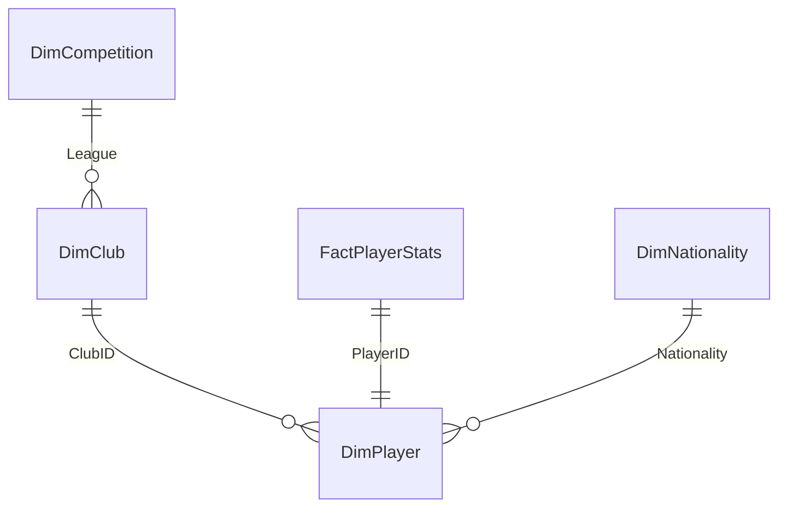

-

# Data Model

The report uses a **star-style model**: one fact table (`FactPlayerStats`) and three dimensions (`DimPlayer`, `DimClub`, `DimCompetition`), plus a nationality lookup and a set of **disconnected calculated tables** that power the radar charts and the peer scatter plots.


## Contents

1. [Table inventory](#table-inventory)
2. [Relationships](#relationships)
3. [Core tables](#core-tables)
4. [Calculated columns](#calculated-columns)
5. [Calculated helper tables](#calculated-helper-tables)
6. [Conventions](#conventions)
7. [Modelling notes & recommendations](#modelling-notes--recommendations)

---

## Table inventory

16 tables in total.

| Table                                                                                              | Type                     | Grain                           | Purpose                                     |
| -------------------------------------------------------------------------------------------------- | ------------------------ | ------------------------------- | ------------------------------------------- |
| `FactPlayerStats`                                                                                  | Imported (CSV)           | one row per player (2024–25)    | All performance metrics                     |
| `DimPlayer`                                                                                        | Imported (CSV)           | one row per player              | Identity, position, nationality, club       |
| `DimClub`                                                                                          | Imported (CSV)           | one row per club (96)           | Club, league, season results, logo          |
| `DimCompetition`                                                                                   | Imported (CSV)           | one row per league              | League and season                           |
| `DimNationality`                                                                                   | Calculated               | one row per nationality code    | Country name and flag URL                   |
| `AttackingRadar`, `MidfieldRadar`, `DefendingRadar`, `GoalkeepingRadar`                            | Calculated, disconnected | one row per radar axis          | Axis list (`Metric`) for each radar chart   |
| `Attackers Peer Table`, `Midfielders Peer Table`, `Defenders Peer Table`, `Goalkeepers Peer Table` | Calculated, disconnected | one row per player in that role | Snapshot for the player scatter plots       |
| `Club Peer Table`                                                                                  | Calculated, disconnected | one row per club                | Snapshot for the four club scatter plots    |
| `Club Result`                                                                                      | Calculated, disconnected | one row per result type         | Wins / Draws / Losses for the results donut |
| `DAX Measures`                                                                                     | Measure container        | —                               | Holds 62 of the 77 measures                 |

---

## Relationships



| #   | From (many / first)         | To (one / second)             | Cardinality    | Cross-filter                          | Active |
| --- | --------------------------- | ----------------------------- | -------------- | ------------------------------------- | ------ |
| 1   | `DimPlayer[ClubID]`         | `DimClub[ClubID]`             | many-to-one    | **Both**                              | ✔      |
| 2   | `FactPlayerStats[PlayerID]` | `DimPlayer[PlayerID]`         | **one-to-one** | **Both**                              | ✔      |
| 3   | `DimPlayer[Nationality]`    | `DimNationality[Nationality]` | many-to-one    | **Both**                              | ✔      |
| 4   | `DimClub[League]`           | `DimCompetition[League]`      | many-to-one    | Single (`DimCompetition` → `DimClub`) | ✔      |

Notes:

- Because relationship 2 is one-to-one, `FactPlayerStats` and `DimPlayer` effectively behave as a single wide table: a player slicer or drillthrough filters both.
- The helper tables (radar, peer, `Club Result`) have **no relationships by design**. That is what lets them ignore slicers and keep every player or club visible.
- League names follow FBref's format (`eng Premier League`, `es La Liga`, `de Bundesliga`, `it Serie A`, `fr Ligue 1`) and nationality codes look like `es ESP`, `fr FRA`.

---

## Core tables

Data types: **Text**, **Whole number**, **Decimal**.

### `DimPlayer` — one row per player (2,854)

| Column                | Type          | Notes                                                                                              |
| --------------------- | ------------- | -------------------------------------------------------------------------------------------------- |
| `PlayerID`            | Whole number  | Surrogate key; relationship to `FactPlayerStats`                                                   |
| `PlayerName`          | Text          |                                                                                                    |
| `Nationality`         | Text          | FBref code (e.g. `es ESP`); FK to `DimNationality`                                                 |
| `Position`            | Text          | One or two tags, comma-separated: `GK`, `DF`, `MF`, `FW`, or combinations such as `FW,MF`, `MF,DF` |
| `PrimaryPosition` \*  | Text          | First position tag; used as the peer group for percentiles                                         |
| `Age`                 | Whole number  |                                                                                                    |
| `BirthYear`           | Whole number  |                                                                                                    |
| `ClubID`              | Whole number  | FK to `DimClub`                                                                                    |
| `ClubName`            | Text          |                                                                                                    |
| `League`              | Text          |                                                                                                    |
| `SlicerPlayerName` \* | Text          | `PlayerName (ClubName)` — unique label for slicers                                                 |
| `Age (bins)` \*       | Decimal       | Nine equal-width age bins for the age histogram                                                    |
| `PlayerImageURL` \*   | Text (hidden) | Constant placeholder avatar; no real player photos                                                 |

### `DimClub` — one row per club (96)

| Column                    | Type             | Notes                                                       |
| ------------------------- | ---------------- | ----------------------------------------------------------- |
| `ClubID`                  | Whole number     | Surrogate key                                               |
| `Club`                    | Text             | FBref-style short name (e.g. `Manchester Utd`, `Paris S-G`) |
| `Country`                 | Text             |                                                             |
| `League`                  | Text             | FK to `DimCompetition`                                      |
| `Total Games`             | Whole number     |                                                             |
| `Wins`, `Draws`, `Losses` | Whole number     |                                                             |
| `Home Wins`, `Away Wins`  | Whole number     |                                                             |
| `Titles Won`              | Whole number     | Period covered not recorded — document before publishing    |
| `LogoURL`                 | Text (Image URL) | Crest URL                                                   |
| `LogoURL_Final` \*        | Text (Image URL) | `LogoURL`, or a placeholder image for 17 clubs              |

League sizes: Premier League 20 · La Liga 20 · Serie A 20 · Bundesliga 18 · Ligue 1 18.

### `DimCompetition`

| Column   | Type | Notes       |
| -------- | ---- | ----------- |
| `League` | Text | Key         |
| `Season` | Text | `2024-2025` |

### `DimNationality` (calculated)

| Column        | Type             | Notes                                 |
| ------------- | ---------------- | ------------------------------------- |
| `Nationality` | Text             | Key; matches `DimPlayer[Nationality]` |
| `Country`     | Text             | Country name shown on profile pages   |
| `FlagURL`     | Text (Image URL) | Flag image                            |

### `FactPlayerStats` — one row per player

All metric columns below are summed or averaged by measures. "Source" is the raw FBref column in the Kaggle file.

| Column                                       | Type         | Source                                | Used for                      |
| -------------------------------------------- | ------------ | ------------------------------------- | ----------------------------- |
| `PlayerID`                                   | Whole number | — (surrogate key)                     | Relationship                  |
| `Season`                                     | Text         | constant                              | General                       |
| `Matches`                                    | Whole number | `MP`                                  | General                       |
| `Minutes`                                    | Whole number | `Min`                                 | General                       |
| `Goals`                                      | Whole number | `Gls`                                 | Attackers                     |
| `Assists`                                    | Whole number | `Ast`                                 | Attackers, Midfielders        |
| `Shots`                                      | Whole number | `Sh`                                  | Attackers                     |
| `ShotAccuracy`                               | Decimal      | `SoT%`                                | Attackers                     |
| `xG`                                         | Decimal      | `xG`                                  | Attackers, clubs              |
| `xA`                                         | Decimal      | `xAG`                                 | Attackers, Midfielders, clubs |
| `GoalsPer90`, `xGPer90`                      | Decimal      | derived (`Gls` / `90s`, `xG` / `90s`) | Attackers                     |
| `PassAccuracy`                               | Decimal      | `Cmp%`                                | Midfielders, Defenders, clubs |
| `KeyPasses`                                  | Whole number | `KP`                                  | Midfielders, clubs            |
| `ProgressivePasses`                          | Whole number | `PrgP`                                | Midfielders, clubs            |
| `ThroughBalls`                               | Whole number | `TB`                                  | Midfielders                   |
| `SuccessfulDribbles`                         | Whole number | `Succ`                                | Attackers, Midfielders        |
| `ShotCreatingActions`, `GoalCreatingActions` | Whole number | `SCA`, `GCA`                          | Attackers, Midfielders, clubs |
| `Tackles`                                    | Whole number | `Tkl`                                 | Defenders                     |
| `TacklesWon`                                 | Whole number | `TklW` (added in Power Query)         | Tackle Success Rate           |
| `Interceptions`                              | Whole number | `Int`                                 | Defenders                     |
| `Blocks`                                     | Whole number | `Blocks_stats_defense`                | Defenders                     |
| `Clearances`                                 | Whole number | `Clr`                                 | Defenders                     |
| `AerialDuelsWon`                             | Whole number | `Won`                                 | Defenders                     |
| `Recoveries`                                 | Whole number | `Recov`                               | Defenders                     |
| `Errors`                                     | Whole number | `Err`                                 | Defenders, Goalkeepers        |
| `Saves`                                      | Whole number | `Saves`                               | Goalkeepers                   |
| `SavePct`                                    | Decimal      | `Save%`                               | Goalkeepers                   |
| `CleanSheets`                                | Whole number | `CS`                                  | Goalkeepers                   |
| `GoalsConceded`                              | Whole number | `GA`                                  | Goalkeepers, clubs            |
| `PostShotxG`                                 | Decimal      | `PSxG` (added in Power Query)         | PSxG Overperformance %        |
| `GoalsPrevented`                             | Decimal      | `PSxG+/-`                             | Goalkeepers                   |
| `PenaltiesSaved`                             | Whole number | `PKsv`                                | Goalkeepers                   |
| `SweeperActions`                             | Whole number | `#OPA`                                | Goalkeepers                   |
| `YellowCards`, `RedCards`                    | Whole number | `CrdY`, `CrdR`                        | General                       |

---

## Calculated columns

```dax
-- DimPlayer[SlicerPlayerName]
DimPlayer[PlayerName] & " (" & DimPlayer[ClubName] & ")"
```

```dax
-- DimPlayer[Age (bins)]  (built with Power BI's binning: 9 bins between min and max age)
VAR __Count = 9
VAR __Min = MIN('DimPlayer'[Age])
VAR __Max = MAX('DimPlayer'[Age])
VAR __Difference = (__Max - __Min)
VAR __Size = IF(__Difference > 0, __Difference / __Count, 1)
VAR __BinNumber = INT(('DimPlayer'[Age] - __Min) / __Size)
RETURN
    IF(
        ISBLANK('DimPlayer'[Age]),
        BLANK(),
        __Min + (MIN(__BinNumber, __Count - 1) * __Size)
    )
```

```dax
-- DimClub[LogoURL_Final]  (placeholder for clubs without a usable crest)
VAR PlaceholderURL = "<placeholder image URL>"
RETURN
IF(
    DimClub[ClubID] IN { 5, 13, 14, 21, 24, 34, 37, 52, 54, 55, 61, 68, 72, 74, 82, 89, 94 },
    PlaceholderURL,
    DimClub[LogoURL]
)
```

`DimPlayer[PrimaryPosition]` is created in Power Query (first tag of `Position`, i.e. the text before the first comma); `PlayerImageURL` is a hidden constant avatar URL.

---

## Calculated helper tables

Their DAX definitions are not part of the metadata export, so they are described by their columns.

| Table                    | Columns                                                                                                                               | Used by                                   |
| ------------------------ | ------------------------------------------------------------------------------------------------------------------------------------- | ----------------------------------------- |
| `AttackingRadar`         | `Metric` — Goals, xG, xA, Shot Accuracy, Successful Dribbles, Goal Creating Actions                                                   | Attacking radar (`Attacking Radar Value`) |
| `MidfieldRadar`          | `Metric` — Key Passes, Pass Accuracy, Progressive Passes, Shot Creating Actions, Successful Dribbles, xA                              | Midfield radar                            |
| `DefendingRadar`         | `Metric` — Aerial Duels Won, Blocks, Clearances, Interceptions, Pass Accuracy, Recoveries, Tackles                                    | Defending radar                           |
| `GoalkeepingRadar`       | `Metric` — Clean Sheets, Goals Prevented, Penalties Saved, Save %, Saves, Sweeper Actions                                             | Goalkeeping radar                         |
| `Attackers Peer Table`   | `PlayerID`, `PlayerName`, `Goals`, `xG`                                                                                               | Goals vs xG scatter                       |
| `Midfielders Peer Table` | `PlayerID`, `PlayerName`, `TotalKeyPasses`, `TotalxA`                                                                                 | Key Passes vs xA scatter                  |
| `Defenders Peer Table`   | `PlayerID`, `PlayerName`, `TotalTackles`, `TotalInterceptions`                                                                        | Interceptions vs Tackles scatter          |
| `Goalkeepers Peer Table` | `PlayerID`, `PlayerName`, `SavePct`, `GoalsPrevented`                                                                                 | Goals Prevented vs Save % scatter         |
| `Club Peer Table`        | `ClubID`, `Club`, `Goals`, `xG`, `xA`, `KeyPasses`, `ProgressivePasses`, `ShotCreatingActions`, `GoalCreatingActions`, `PassAccuracy` | Four club scatters                        |
| `Club Result`            | `Result` — Wins, Draws, Losses                                                                                                        | Results donut (`Result Count`)            |

Each peer table is a **frozen snapshot** computed at refresh time, so slicers cannot filter it; a measure reads the current selection from `DimPlayer` / `DimClub` to highlight one point.

---

## Conventions

- **Keys:** `PlayerID`, `ClubID` are surrogate integers created in Python; filter and relate on IDs, not names.
- **Measure naming:** `…%` = percentile (0–100) · `Overall … Score` = weighted sum of percentiles · `Is Selected …` = 1/0 highlight flag · `… Bubble Size` = marker size.
- **Positions:** tags are `GK`, `DF`, `MF`, `FW`; hybrid players carry two tags. Use `CONTAINSSTRING` for "any role" logic and `PrimaryPosition` for "one role" logic.
- **Images:** columns holding image links use the _Image URL_ data category.
- **Folders:** measures are grouped in display folders by page (`Overview page`, `Player Profile page\Attackers`, `Team Analysis page`, …).

## Modelling notes & recommendations

- **Bi-directional filters** on relationships 1–3 make synced slicers convenient but can introduce ambiguity and slower visuals. Test whether single-direction filtering gives identical results.
- **One-to-one** between `FactPlayerStats` and `DimPlayer` is valid for a single season. If more seasons are added, make it one-to-many and include `Season` in the grain.
- **Joins on name + club** (used when attaching `TacklesWon` and `PostShotxG` from the raw file) are fragile for mid-season transfers and players sharing a name — check for nulls and duplicates after the merge.

- **`DimPlayer` / `FactPlayerStats` grain:** confirm there are no duplicate `PlayerID`s after every refresh.

---
