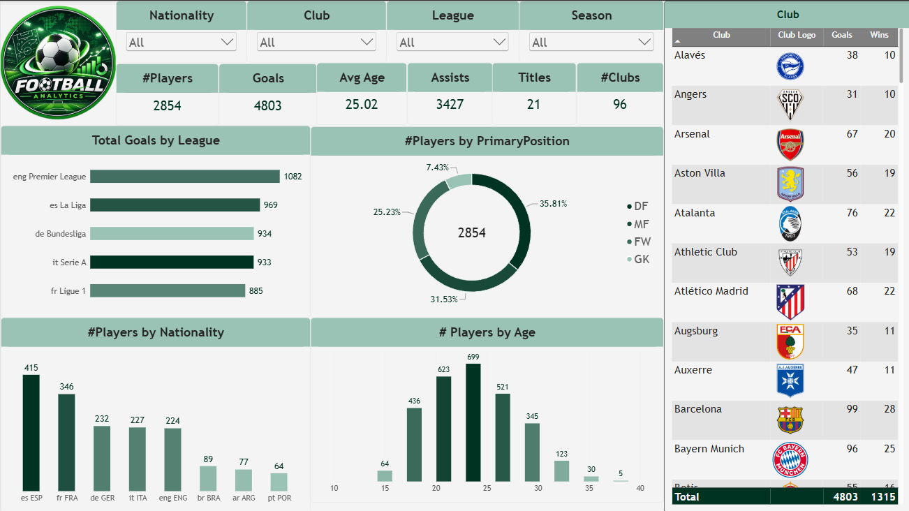
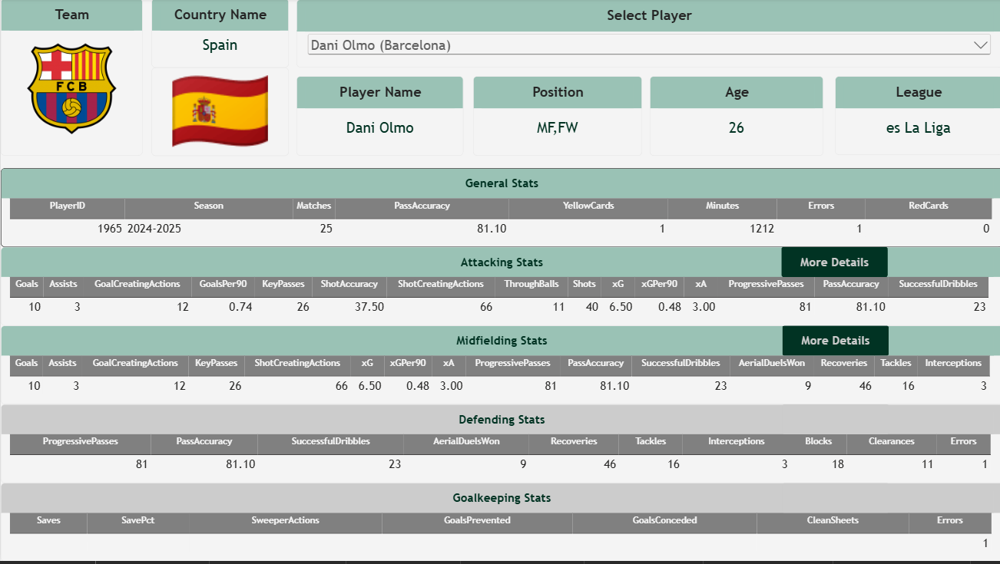
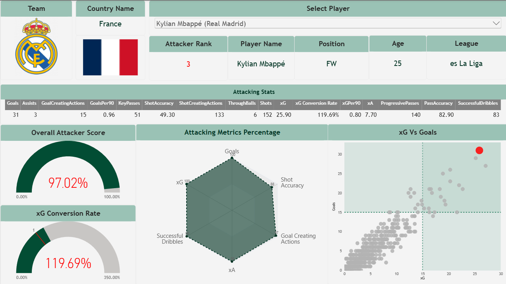
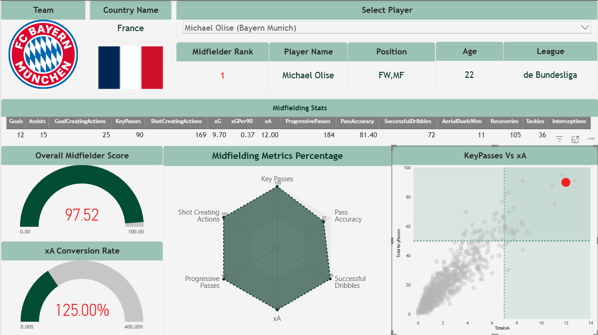
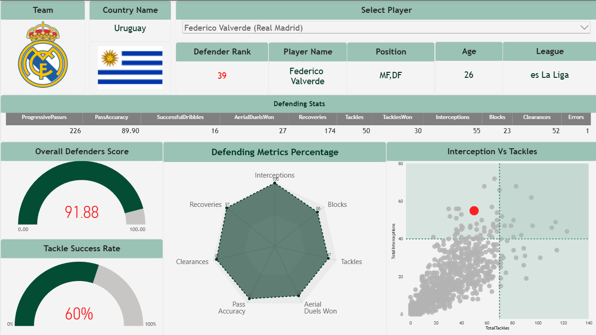
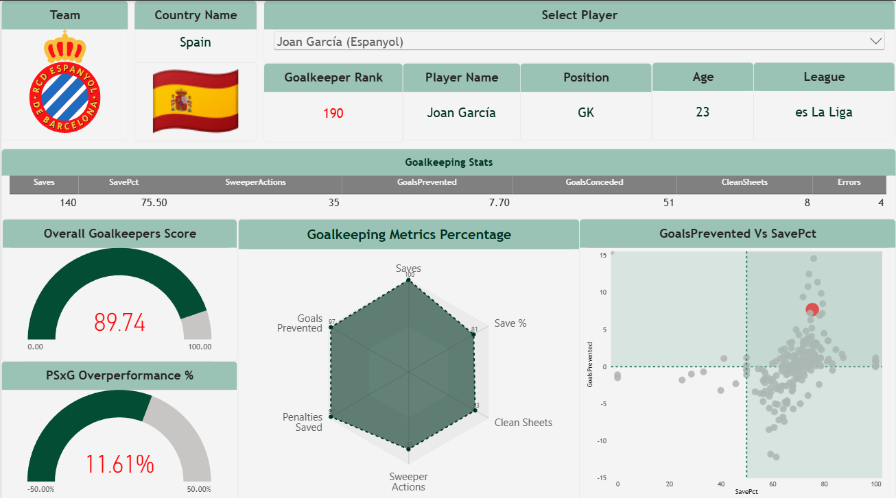
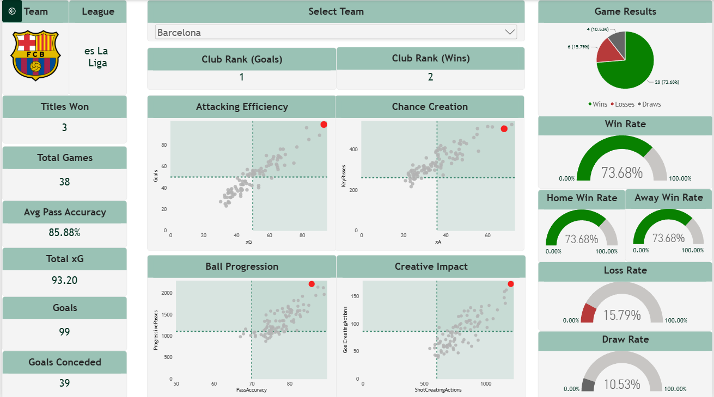
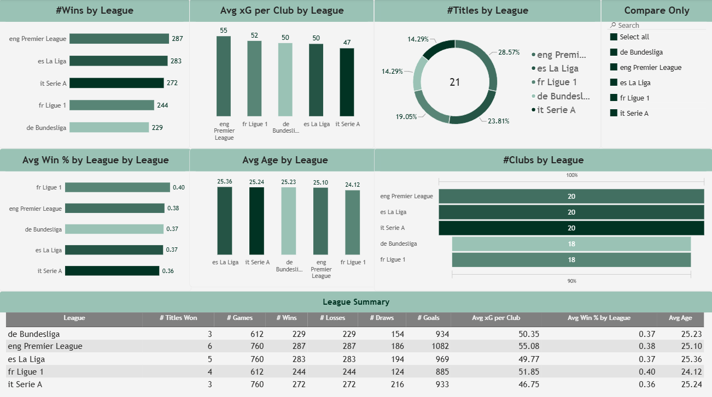

# Power BI Report Guide

This folder documents the Power BI report: what each page shows, how the interactions work, and every measure behind the visuals.
For tables, columns and relationships see [`../docs/data-model.md`](../Docs/data-model.md).

**Report at a glance**

| Item            | Value                                                                                                          |
| --------------- | -------------------------------------------------------------------------------------------------------------- |
| Pages           | 8 (Overview, Player Profile, Attackers, Midfielders, Defenders, Goalkeepers, Team Analysis, League Comparison) |
| Model tables    | 16 (4 imported star-schema tables, 11 calculated helper tables, 1 measure container)                           |
| Measures        | 77 (62 in the `DAX Measures` container, 15 attached to helper tables)                                          |
| Players / clubs | 2,854 / 96                                                                                                     |
| Season          | 2024–25                                                                                                        |
| Theme           | Green: header bands `#9AC2B5`, dark-green accents, grey `#CCCCCC` for inactive states                          |

---

## Contents

1. [Report-wide interactions](#report-wide-interactions)
2. [Page walkthrough](#page-walkthrough)
3. [Measures reference](#measures-reference)
4. [Key DAX patterns](#key-dax-patterns)

---

## Report-wide interactions

- **Synced player slicer** — the _Select Player_ dropdown is synced across Player Profile and the four position pages. It shows `Name (Club)` (calculated column `SlicerPlayerName`) so players who share a name stay distinguishable.
- **Drillthrough with `PlayerID`** — on Player Profile, _More Details_ buttons carry the selected player to the matching position page. Buttons are only visible when the player's position matches (`FW` → Attackers, `MF` → Midfielders, `DF` → Defenders, `GK` → Goalkeepers); players with two positions see two buttons.
- **Position-aware colours** — each stat table header turns green (`#9AC2B5`) when the player's position matches and grey (`#CCCCCC`) otherwise, driven by measures such as `Attacking Stats Color`.
- **Drillthrough with `ClubID`** — Team Analysis receives the selected club from the Overview, with a Back button.
- **Disconnected peer tables** — all scatter plots read from snapshot tables so every player/club stays visible while the selection is highlighted (red, enlarged).
- **Bookmarks** store display states only; filtering is done by slicers, drillthrough and measures.
- **Images** — `LogoURL_Final` (club crest with placeholder fallback) and `FlagURL` use the _Image URL_ data category.

---

## Page walkthrough

### 1. Overview



- **Filters:** Nationality, Club, League, Season.
- **KPI cards:** `#Players` 2,854 · `Goals` 4,803 · `Avg Age` 25.02 · `Assists` 3,427 · `Titles` 21 · `#Clubs` 96.
- **Visuals:** Total Goals by League (bar) · #Players by PrimaryPosition (donut) · #Players by Nationality (column) · #Players by Age (histogram using the calculated `Age (bins)` column) · club table with crest, goals and wins.
- **Measures:** `Total Players`, `Average Age`, `Total Clubs`, `Total Goals`, `Total Assists`.

### 2. Player Profile



_Example: Dani Olmo (`MF,FW`) — the Attacking and Midfielding tables are highlighted, Defending and Goalkeeping are greyed out._

- **Header:** club crest, country name and flag, player slicer, player name, position, age, league.
- **Five stat tables:** General · Attacking · Midfielding · Defending · Goalkeeping. Only the tables relevant to the player's position are highlighted.
- **Buttons:** _More Details_ next to each relevant table drills through to the position page.
- **Measures:** `Selected Player Position`, `General Stats Color`, `Attacking Stats Color`, `Midfield Stats Color`, `Defending Stats Color`, `Goalkeeping Table Color`.

### 3. Attackers (drillthrough)



_Example: Kylian Mbappé — rank 3, overall score 97.02%, xG conversion 119.69% (31 goals from 25.9 xG)._

- **Cards:** Attacker Rank · Player Name · Position · Age · League · attacking stats table (includes `xG Conversion Rate`).
- **Visuals:** _Overall Attacker Score_ gauge · _xG Conversion Rate_ gauge (0–350%, target 100%) · _Attacking Metrics Percentage_ radar (Goals, xG, xA, Shot Accuracy, Successful Dribbles, Goal-Creating Actions) · _xG vs Goals_ peer scatter with quadrant guides.
- **Key measures:** `Overall Attacker Score`, `Attacker Rank`, `xG Conversion Rate`, `Max/Min/Target xG Conversion`, `Attacking Radar Value`, `Is Selected Attacker`, `Attacker Bubble Size`.

### 4. Midfielders (drillthrough)



_Example: Michael Olise (`FW,MF`) — rank 1, overall score 97.52, xA conversion 125%._

- **Visuals:** _Overall Midfielder Score_ gauge · _xA Conversion Rate_ gauge (0–400%) · _Midfielding Metrics Percentage_ radar (Key Passes, Pass Accuracy, Successful Dribbles, xA, Progressive Passes, Shot-Creating Actions) · _Key Passes vs xA_ peer scatter.
- **Key measures:** `Overall Midfielder Score`, `Midfielder Rank`, `xA Conversion Rate`, `Midfield Radar Value`, `Is Selected Midfielder`, `Midfielder Bubble Size`.

### 5. Defenders (drillthrough)



_Example: Federico Valverde (`MF,DF`) — rank 39, overall score 91.88, tackle success 60% (30 of 50)._

- **Visuals:** _Overall Defenders Score_ gauge · _Tackle Success Rate_ gauge · _Defending Metrics Percentage_ radar (7 axes: Interceptions, Blocks, Tackles, Aerial Duels Won, Pass Accuracy, Clearances, Recoveries) · _Interceptions vs Tackles_ peer scatter.
- **Key measures:** `Overall Defenders Score`, `Tackle Success Rate`, `Defending Radar Value`, `Is Selected Defender`, `Defender Bubble Size`.

### 6. Goalkeepers (drillthrough)



_Example: Joan García (Espanyol) — overall score 89.74, PSxG overperformance 11.61%._

- **Visuals:** _Overall Goalkeepers Score_ gauge · _PSxG Overperformance %_ gauge (−50% to +50%) · _Goalkeeping Metrics Percentage_ radar (Saves, Save %, Clean Sheets, Sweeper Actions, Penalties Saved, Goals Prevented) · _Goals Prevented vs Save %_ peer scatter.
- **Key measures:** `Overall Goalkeepers Score`, `PSxG Overperformance %`, `Goalkeeping Radar Value`, `Is Selected Goalkeeper`, `Goalkeeper Bubble Size`.

### 7. Team Analysis (drillthrough on `ClubID`)



_Example: Barcelona — 99 goals (rank 1 by goals), 28 W / 4 D / 6 L, 39 goals conceded._

- **Header:** Back button, crest, league, single-select team slicer, _Club Rank (Goals)_, _Club Rank (Wins)_.
- **KPI cards:** Titles Won · Total Games · Avg Pass Accuracy · Total xG · Goals · Goals Conceded.
- **Peer scatters (selected club in red):** Attacking Efficiency (xG vs Goals) · Chance Creation (xA vs Key Passes) · Ball Progression (Pass Accuracy vs Progressive Passes) · Creative Impact (Shot-Creating vs Goal-Creating Actions).
- **Results:** Game Results donut + Win / Home Win / Away Win / Loss / Draw rate gauges.
- **Key measures:** `Club Total Goals`, `Club Total xG`, `Club Goals Conceded`, `Club Avg Pass Accuracy`, `Club Rank by Goals`, `Club Rank by Win %`, `Club Win %`, `Club Draw %`, `Club Loss %`, `Home Win %`, `Away Win %`, `Result Count`, `Is Selected Club`, `Club Bubble Size`.

### 8. League Comparison



- **Visuals:** #Wins by League · Avg xG per Club by League · #Titles by League (donut) · Avg Win % by League · Avg Age by League · #Clubs by League (funnel) · League Summary table · _Compare Only_ league slicer.
- **Key measures:** `Total Goals by League`, `Avg xG per Club`, `Avg Win % by League`, `Avg Age`, `Total Titles by League`.

---

## Measures reference

All 62 container measures live in the `DAX Measures` table, organised in display folders.

| Display folder                      | Measures                                                                                                                                                                                                           |
| ----------------------------------- | ------------------------------------------------------------------------------------------------------------------------------------------------------------------------------------------------------------------ |
| **Overview page**                   | `Total Players` · `Average Age` · `Total Clubs` · `Total Goals` · `Total Assists`                                                                                                                                  |
| **Player Profile page \ Attackers** | `Goals%` · `xG%` · `ShotAccuracy%` · `GoalCreatingActions%` · `xG Conversion Rate` · `Max xG Conversion` (3.5) · `Min xG Conversion` (0) · `Target xG Conversion` (1) · `Overall Attacker Score` · `Attacker Rank` |
| **… \ Attackers + Midfielders**     | `xA%` · `SuccessfulDribbles%`                                                                                                                                                                                      |
| **… \ Midfielders**                 | `KeyPasses%` · `ProgressivePasses%` · `ShotCreatingActions%` · `Overall Midfielder Score` · `xA Conversion Rate` · `Midfielder Rank`                                                                               |
| **… \ Midfielders + Defenders**     | `PassAccuracy%`                                                                                                                                                                                                    |
| **… \ Defenders**                   | `Tackles%` · `Interceptions%` · `Blocks%` · `Clearances%` · `AerialDuelsWon%` · `Recoveries%` · `Overall Defenders Score` · `Tackle Success Rate`                                                                  |
| **… \ Goalkeepers**                 | `Saves%` · `SavePct%` · `SweeperActions%` · `PenaltiesSaved%` · `GoalsPrevented%` · `CleanSheets%` · `Overall Goalkeepers Score` · `PSxG Overperformance %`                                                        |
| **Player Profile page \ Colors**    | `Selected Player Position` · `General Stats Color` · `Attacking Stats Color` · `Midfield Stats Color` · `Defending Stats Color` · `Goalkeeping Table Color`                                                        |
| **Team Analysis page**              | `Club Total Goals` · `Club Total xG` · `Club Avg Pass Accuracy` · `Club Rank by Goals` · `Club Goals Conceded` · `Club Win %` · `Club Draw %` · `Club Loss %` · `Club Rank by Win %` · `Away Win %` · `Home Win %` |
| **League Comparison page**          | `Avg Age` · `Avg Win % by League` · `Total Titles by League` · `Avg xG per Club` · `Total Goals by League`                                                                                                         |

**Measures attached to helper tables (15)**

| Table                                                                      | Measures                                                                                               |
| -------------------------------------------------------------------------- | ------------------------------------------------------------------------------------------------------ |
| `AttackingRadar` / `MidfieldRadar` / `DefendingRadar` / `GoalkeepingRadar` | `Attacking Radar Value` · `Midfield Radar Value` · `Defending Radar Value` · `Goalkeeping Radar Value` |
| `Attackers Peer Table`                                                     | `Is Selected Attacker` · `Attacker Bubble Size`                                                        |
| `Midfielders Peer Table`                                                   | `Is Selected Midfielder` · `Midfielder Bubble Size`                                                    |
| `Defenders Peer Table`                                                     | `Is Selected Defender` · `Defender Bubble Size`                                                        |
| `Goalkeepers Peer Table`                                                   | `Is Selected Goalkeeper` · `Goalkeeper Bubble Size`                                                    |
| `Club Peer Table`                                                          | `Is Selected Club` · `Club Bubble Size`                                                                |
| `Club Result`                                                              | `Result Count`                                                                                         |

**Naming conventions:** a `%` suffix marks a _percentile_ measure (0–100) used by radars and scores; `Overall … Score` is a weighted sum of percentiles; `Is Selected …` returns 1/0 for highlighting; `… Bubble Size` returns 5 for the selected item and 1 otherwise.

---

## Key DAX patterns

### Percentile within the same position group

Every `…%` measure follows this pattern (shown for `Goals%`); only the column changes.

```dax
Goals% =
VAR SelectedPlayerID = SELECTEDVALUE(DimPlayer[PlayerID])
VAR SelectedPosition = LOOKUPVALUE(DimPlayer[PrimaryPosition], DimPlayer[PlayerID], SelectedPlayerID)
VAR SelectedX = SELECTEDVALUE(FactPlayerStats[Goals])
VAR PeerGroup =
    FILTER(
        ALL(FactPlayerStats),
        RELATED(DimPlayer[PrimaryPosition]) = SelectedPosition
    )
VAR TotalPeers = COUNTROWS(PeerGroup)
VAR RankedBelow = COUNTROWS(FILTER(PeerGroup, FactPlayerStats[Goals] <= SelectedX))
RETURN DIVIDE(RankedBelow, TotalPeers) * 100
```

### Weighted overall score and rank

```dax
Overall Attacker Score =
([Goals%] * 0.20 +
 [xG%] * 0.16 + [xA%] * 0.16 + [ShotAccuracy%] * 0.16 +
 [SuccessfulDribbles%] * 0.16 + [GoalCreatingActions%] * 0.16) / 100

Attacker Rank =
VAR Attackers =
    FILTER(ALL(DimPlayer), CONTAINSSTRING(DimPlayer[Position], "FW"))
RETURN
    RANKX(Attackers, CALCULATE([Overall Attacker Score]), , DESC, DENSE)
```

### Efficiency measure with a minimum-sample guard

```dax
xG Conversion Rate =
VAR MinxGThreshold = 0.5
VAR TotalxG = SUM(FactPlayerStats[xG])
VAR TotalGoals = SUM(FactPlayerStats[Goals])
RETURN
    IF(TotalxG >= MinxGThreshold, DIVIDE(TotalGoals, TotalxG, BLANK()), BLANK())
```

`xA Conversion Rate`, `Tackle Success Rate` (≥ 10 tackles) and `PSxG Overperformance %` (≥ 5 PSxG) use the same structure.

### Radar value selector

Each radar uses a one-column disconnected table (`Metric`) and a `SWITCH` measure.

```dax
Attacking Radar Value =
SWITCH(
    SELECTEDVALUE(AttackingRadar[Metric]),
    "Goals", [Goals%],
    "xG", [xG%],
    "xA", [xA%],
    "Shot Accuracy", [ShotAccuracy%],
    "Successful Dribbles", [SuccessfulDribbles%],
    "Goal Creating Actions", [GoalCreatingActions%]
)
```

### Peer-highlight scatter

```dax
Is Selected Attacker =
VAR SelectedPlayer = SELECTEDVALUE(DimPlayer[PlayerName])
RETURN IF(SELECTEDVALUE('Attackers Peer Table'[PlayerName]) = SelectedPlayer, 1, 0)

Attacker Bubble Size = IF([Is Selected Attacker] = 1, 5, 1)
```

The peer table has **no relationships**, so a slicer on `DimPlayer` can't filter it; the measure reads the slicer selection from `DimPlayer` and compares it with the current dot. Colour comes from conditional formatting on `Is Selected …`, size from `… Bubble Size`.

### Position-aware table colour

```dax
Attacking Stats Color =
VAR Pos = [Selected Player Position]
RETURN IF(CONTAINSSTRING(Pos, "FW"), "#9AC2B5", "#CCCCCC")
```

### Club results and ranking

```dax
Club Win %  = DIVIDE(SUM(DimClub[Wins]), SUM(DimClub[Total Games]))
Home Win %  = DIVIDE(SUM(DimClub[Home Wins]), SUM(DimClub[Total Games]) / 2)
Club Rank by Win % = RANKX(ALL(DimClub), [Club Win %], , DESC, DENSE)

Club Goals Conceded =
CALCULATE(
    SUM(FactPlayerStats[GoalsConceded]),
    FILTER(DimPlayer, CONTAINSSTRING(DimPlayer[Position], "GK"))
)
```

`Home Win %` / `Away Win %` use `Total Games / 2` as the number of home (or away) games because the model has no separate home/away game counts — an approximation that assumes a balanced round-robin schedule.

---
