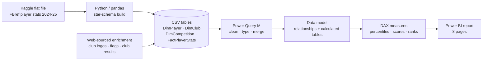
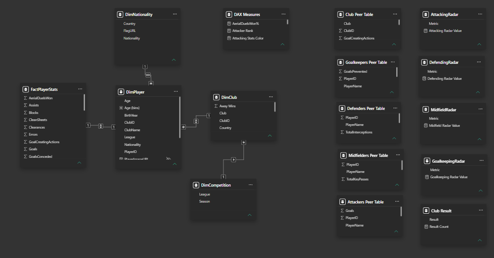

# ⚽ Football Players & Clubs Analytics — Big 5 Leagues, 2024–25

An interactive **Power BI** report that lets you explore **2,854 players and 96 clubs** across the Premier League, La Liga, Bundesliga, Serie A and Ligue 1.
It is built to **compare players against their positional peers, spot under-the-radar talent, find players with similar profiles, compare clubs, and compare leagues** — all in one consistent green-themed dashboard.


---

## Table of contents

1. [Project goals](#project-goals)
2. [Dashboard tour](#dashboard-tour)
3. [Highlights from the data](#highlights-from-the-data)
4. [How the analysis works](#how-the-analysis-works)
5. [Tech stack & pipeline](#tech-stack--pipeline)
6. [Data sources](#data-sources)
7. [Repository structure](#repository-structure)
8. [How to reproduce](#how-to-reproduce)
9. [Limitations & status](#limitations--status)
10. [Credits & disclaimer](#credits--disclaimer)

---

## Project goals

| Question                                                                            | Where to find the answer                                                                |
| ----------------------------------------------------------------------------------- | --------------------------------------------------------------------------------------- |
| Who is this player, and how good is he compared with others who play the same role? | **Player Profile** + the four position pages (percentile radar, overall score, rank)    |
| Is a forward finishing above or below what his chances suggest?                     | **Attackers** (xG conversion, Goals vs xG scatter)                                      |
| Who creates chances, wins the ball back, or keeps goal best?                        | **Midfielders**, **Defenders**, **Goalkeepers**                                         |
| Which players look similar to a given player?                                       | Peer scatter plots show every player in the same role with the selected one highlighted |
| How does a club perform, and how does it rank?                                      | **Team Analysis** (results, ranks, four club scatter plots)                             |
| Which league is the most attacking, youngest, or most successful?                   | **League Comparison**                                                                   |

## Dashboard tour

| Page                  | What it shows                                                                                                                                                                                                                                                     | Screenshot                                                        |
| --------------------- | ----------------------------------------------------------------------------------------------------------------------------------------------------------------------------------------------------------------------------------------------------------------- | ----------------------------------------------------------------- |
| **Overview**          | Slicers (Nationality, Club, League, Season), KPI cards, goals by league, players by position / nationality / age, club table with crests                                                                                                                          | [view](powerbi/screenshots/Overview.png)                          |
| **Player Profile**    | One dynamic page for every player: club crest, nationality flag, five stat tables (General, Attacking, Midfielding, Defending, Goalkeeping) that light up according to the player's position, and _More Details_ buttons that drill through to the position pages | [view](powerbi/screenshots/PlayerProfile_olmo-multi-position.png) |
| **Attackers**         | Attacker rank, overall score, xG conversion gauge, percentile radar, Goals vs xG scatter                                                                                                                                                                          | [view](powerbi/screenshots/Attackers_mbappe.png)                  |
| **Midfielders**       | Midfielder rank, overall score, xA conversion gauge, percentile radar, Key Passes vs xA scatter                                                                                                                                                                   | [view](powerbi/screenshots/Midfielders_olise.png)                 |
| **Defenders**         | Defender rank, overall score, tackle success gauge, 7-axis percentile radar, Interceptions vs Tackles scatter                                                                                                                                                     | [view](powerbi/screenshots/Defenders_valverde.png)                |
| **Goalkeepers**       | Goalkeeper rank, overall score, PSxG overperformance gauge, percentile radar, Goals Prevented vs Save % scatter                                                                                                                                                   | [view](powerbi/screenshots/Goalkeepers_garcia.png)                |
| **Team Analysis**     | Single-select club, goal / win ranks, results donut, win / draw / loss / home / away rate gauges, four club peer scatters                                                                                                                                         | [view](powerbi/screenshots/Team_barcelona.png)                    |
| **League Comparison** | Wins, xG per club, titles, win %, average age and clubs per league, plus a summary table                                                                                                                                                                          | [view](powerbi/screenshots/LeagueComparison.png)                  |

<table>
  <tr>
    <td></td>
    <td></td>
  </tr>
  <tr>
    <td></td>
    <td></td>
  </tr>
</table>

A full page-by-page walkthrough (visuals, interactions, measures) is in [`powerbi/README.md`](powerbi/README.md).

## Highlights from the data

Figures below are read directly from the dashboard.

- **Scale:** 2,854 players · 96 clubs · 4,803 goals · 3,427 assists · average age 25.02.
- **Most goals:** the Premier League leads with 1,082 goals, ahead of La Liga (969), Bundesliga (934), Serie A (933) and Ligue 1 (885). It also has the highest average xG per club (55.1).
- **Age:** Ligue 1 is the youngest league (24.12 average age); La Liga the oldest (25.36). Most players are in their early-to-mid 20s.
- **Win rates:** Ligue 1 has the highest average win rate (0.40); Serie A the lowest (0.36), helped by having the most draws (216).
- **Squad mix:** defenders 35.8% · midfielders 31.5% · forwards 25.2% · goalkeepers 7.4%. Spain (415) and France (346) supply the most players.
- **Club example:** Barcelona top the goals table with 99, and finished 28 wins – 4 draws – 6 losses (73.68% win rate) with 39 goals conceded.

## How the analysis works

**Position-aware percentiles.** Each metric is converted to a 0–100 percentile **against players with the same primary position**, so a centre-back is never compared with a striker. These percentiles feed the radar charts and the overall scores.

**Overall scores** are weighted sums of six or seven percentile components:

| Role       | Weights                                                                                                     |
| ---------- | ----------------------------------------------------------------------------------------------------------- |
| Attacker   | Goals 20% · xG, xA, Shot Accuracy, Successful Dribbles, Goal-Creating Actions 16% each                      |
| Midfielder | xA 20% · Key Passes, Pass Accuracy, Progressive Passes, Shot-Creating Actions, Successful Dribbles 16% each |
| Defender   | Recoveries 16% · Blocks, Pass Accuracy, Aerial Duels Won, Clearances, Tackles, Interceptions 14% each       |
| Goalkeeper | Save % 20% · Saves, Sweeper Actions, Goals Prevented, Penalties Saved, Clean Sheets 16% each                |

**Efficiency gauges** compare actual output with expected output, and return blank below a minimum sample so tiny samples don't produce misleading spikes:

| Measure                | Formula                        | Minimum sample |
| ---------------------- | ------------------------------ | -------------- |
| xG Conversion Rate     | Goals ÷ xG                     | xG ≥ 0.5       |
| xA Conversion Rate     | Assists ÷ xA                   | xA ≥ 0.5       |
| Tackle Success Rate    | Tackles won ÷ Tackles          | Tackles ≥ 10   |
| PSxG Overperformance % | (PSxG − Goals conceded) ÷ PSxG | PSxG ≥ 5       |

**Peer scatter plots.** A scatter built on the player table collapses to a single dot as soon as a slicer selects one player. Instead, each scatter reads from a **disconnected snapshot table** that always contains every player (or club), and an `Is Selected …` measure highlights and enlarges the chosen one — so you always see where the selection sits in the crowd.

**Multi-position players** (e.g. `FW,MF`) are matched with `CONTAINSSTRING`, so they appear on more than one position page; the colour of each stat table and the visibility of each _More Details_ button follow the same logic.

## Tech stack & pipeline

**Python (pandas)** · **Power Query (M)** · **DAX** · **Power BI Desktop**



Data model details: [`docs/data-model.md`](Docs/data-model.md)



## Data sources

| Data                                                                | Source                                                                                                                                                                                                         |
| ------------------------------------------------------------------- | -------------------------------------------------------------------------------------------------------------------------------------------------------------------------------------------------------------- |
| Player statistics                                                   | [Football Players Stats (2024–2025)](https://www.kaggle.com/datasets/hubertsidorowicz/football-players-stats-2024-2025) by Hubert Sidorowicz on Kaggle — a flat file of FBref player statistics (250+ columns) |
| Club logos                                                          | Collected from public web sources (Wikimedia-hosted image URLs); 17 clubs without a usable logo fall back to a placeholder image                                                                               |
| Nationality flags                                                   | Collected from public web sources and stored as `FlagURL` in `DimNationality`                                                                                                                                  |
| Club results (games, wins, draws, losses, home / away wins, titles) | Added to `DimClub` from a separate source                                                                                                                                                                      |

The raw Kaggle file is **not** redistributed here. See the `.gitignore` note and [How to reproduce](#how-to-reproduce).

## Repository structure

```
football-analytics-powerbi/
├── README.md                      # this file
├── .gitignore
├── scripts/
│   └── Building_StarSchema.py     # flat CSV -> DimPlayer, DimClub, DimCompetition, FactPlayerStats
├── powerbi/
│   ├── README.md                  # report guide: pages, interactions, measures
│   └── screenshots/               # one screenshot per report page
└── docs/
    ├── data-model.md              # tables, columns, relationships, calculated tables
    └── data-model.png             # model diagram
```

## How to reproduce

1. **Get the data** — download `players_data-2024_2025.csv` from the Kaggle link above.
2. **Build the star schema**
   ```bash
   pip install pandas
   python scripts/Building_StarSchema.py
   ```
   This writes `DimPlayer.csv`, `DimClub.csv`, `DimCompetition.csv` and `FactPlayerStats.csv`.
3. **Enrich the dimensions** — add `LogoURL` and the club results columns to `DimClub`, and a nationality → country / flag lookup (`DimNationality`).
4. **Load into Power BI**, then in Power Query add `PrimaryPosition` to `DimPlayer` and attach `TacklesWon` and `PostShotxG` to `FactPlayerStats` (two columns that come from the raw file).
5. **Recreate the model and measures** using [`docs/data-model.md`](docs/data-model.md) and [`powerbi/README.md`](powerbi/README.md).

## Limitations & status

- **Single season (2024–25)** — no career trend or year-on-year comparison.
- **No player photos** — profile pages use the club crest and nationality flag instead.
- **No market value, salary, height, weight or preferred foot** in the source data.
- **No possession or event/location data**, so no heatmaps and no possession KPI on the team page.

## Credits & disclaimer

- Player statistics: FBref, via the Kaggle dataset by Hubert Sidorowicz.
- Club logos and flags belong to their respective owners and are used for non-commercial, educational and portfolio purposes only.
- This project is not affiliated with any league, club or data provider.

## Author

**[Ahmed Omar]**

- LinkedIn: [[LinkedIn profile](https://www.linkedin.com/in/ahmed-mohamed-omer-439ab6277/)]
